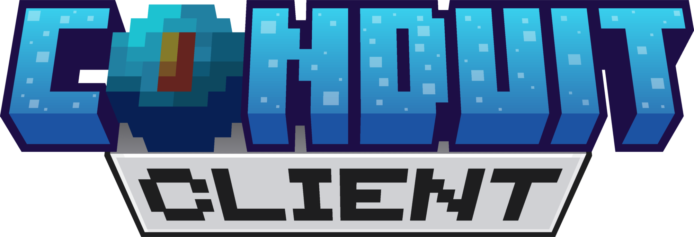

 
<p align="center">
  
</p>

<h1></h1>

<p align="center">
  A DLL-based development client for Minecraft: Bedrock Edition, designed to make JSON UI development faster, easier, and more efficient.
</p>

<div align="center">
  <a href="https://discord.gg/bestack">
    
  </a>
  
</div>

<h2>Introduction</h2>

**Conduit Client** is a Minecraft: Bedrock Edition DLL-based development tool that simplifies the process of creating, testing, and debugging **JSON User Interfaces**.

With targeted JSON UI hot reloading, real-time diagnostics, screen detection, and native Minecraft integration, Conduit Client helps developers iterate faster without repeatedly restarting Minecraft.

The project is actively developed, with more debugging, profiling, and development tools planned for future releases.

## Features

- **JSON UI Hot Reload** — Reload JSON UI definitions without restarting Minecraft or rejoining a world.
- **Developer Diagnostics** — Inspect runtime information through an in-game debug overlay.
- **Screen Detection** — Identify the currently active Minecraft UI screen.
- **Element Statistics** — Monitor runtime UI element counts and factory statistics.
- **Performance Monitoring** — View FPS, reload latency, and operation counters.
- **Version Compatibility** — A dedicated compatibility framework for verified Minecraft Bedrock versions.

## Installation

1. Download the latest compatible `ConduitClient.dll` from the [GitHub Releases](https://github.com/Conduit-BE/client/releases).
2. Verify the downloaded DLL against the provided `SHA256SUMS` file.
3. Configure your Windows x64 DLL injector or BedrockOnLinux's built-in injector to load `ConduitClient.dll`.
4. Launch a supported Minecraft: Bedrock Edition version.
5. Open a world with your development resource pack enabled.
6. Modify a JSON UI file and press **Ctrl + R** to reload its definitions.

Conduit Client automatically initializes its supported components and uses targeted JSON UI reloading. No manual resource-pack path or reload-mode configuration is required.

The resource pack must already be active in Minecraft. Conduit Client does not install or activate resource packs.

[Full installation, building, and troubleshooting documentation](docs/standalone-initialization.md).

## Keybinds

Conduit Client provides keyboard shortcuts to simplify your JSON UI development workflow.

| Keybind | Action | Description |
|---|---|---|
| <code>Ctrl&nbsp;+&nbsp;R</code> | Reload JSON UI | Reloads JSON UI definitions from the active development resource pack. |
| `F3` | Toggle Diagnostics | Shows or hides the debug overlay with screen information, UI statistics, and performance metrics. |
| <code>Ctrl&nbsp;+&nbsp;K</code> | Eject Client | Safely deactivates or unloads Conduit Client from the running Minecraft instance. |

## Diagnostics

The in-game diagnostics overlay provides real-time information about Minecraft's UI environment and Conduit Client's operations.

Available diagnostics include:

- Current active screen.
- Runtime UI element and binding count.
- UI factory statistics and per-factory breakdown.
- Frames per second (FPS).

Press `F3` to toggle the diagnostics overlay.

## Version Compatibility

Conduit Client uses a version-aware compatibility system to manage native integration with Minecraft Bedrock.

Each supported Minecraft version requires a verified compatibility profile containing the necessary native addresses, structures, and feature availability.

The framework is designed to support multiple Minecraft versions within a single DLL in the future.

**Current verified target:** Minecraft Bedrock `1.26.60.5`.

Unsupported versions are rejected safely rather than attempting to execute unverified native functionality.

## Configuration and Logs

Conduit Client stores its configuration and diagnostic logs under:

`%LOCALAPPDATA%\ConduitClient\`

```text
ConduitClient/
├── config.json
└── logs/
    ├── standalone.log
    ├── native-stages.log
    └── client.log
```

### Log files

- `standalone.log` — Initialization, compatibility checks, and startup errors.
- `native-stages.log` — Native integration, dispatch operations, and internal failures.
- `client.log` — Client operations, keyboard shortcuts, and JSON UI validation errors.

The `logs` directory is created automatically when required.

## Limitations

Conduit Client is currently a beta development tool and relies on native integration with Minecraft Bedrock.

- Only explicitly verified Minecraft versions are supported.
- JSON UI hot reloading targets UI definitions rather than all game resources.
- Some UI changes may require closing and reopening the affected screen.
- Unsupported native features are disabled rather than executed with unverified addresses.
- DLL ejection may fall back to safe deactivation when complete unloading cannot be guaranteed.
- The main-menu logo replacement is scoped exclusively to Minecraft's title screen.

Features involving native Minecraft functionality may require additional in-game verification after updates.

## Development

Conduit Client is actively developed with a focus on stability, performance, and developer experience.

Useful resources:

- [Standalone installation and build](docs/standalone-initialization.md)
- [Foundation API and tests](docs/build.md)
- [Native JSON UI reverse-engineering research](docs/reverse-engineering/1.26.60-json-ui-only-prototype.md)
- [Development handoff](docs/development-handoff.md)
- [Reverse-engineering tools](tools/reverse-engineering/README.md)
- [Project guidance](AGENTS.md)
- [Foundation C API](include/conduit/api.h)
- [Third-party notices](THIRD_PARTY_NOTICES.txt)

## Disclaimer

Conduit Client is an independent, experimental development tool and is not affiliated with, endorsed by, or associated with Mojang Studios or Microsoft.

Minecraft and Minecraft: Bedrock Edition are trademarks of their respective owners.
